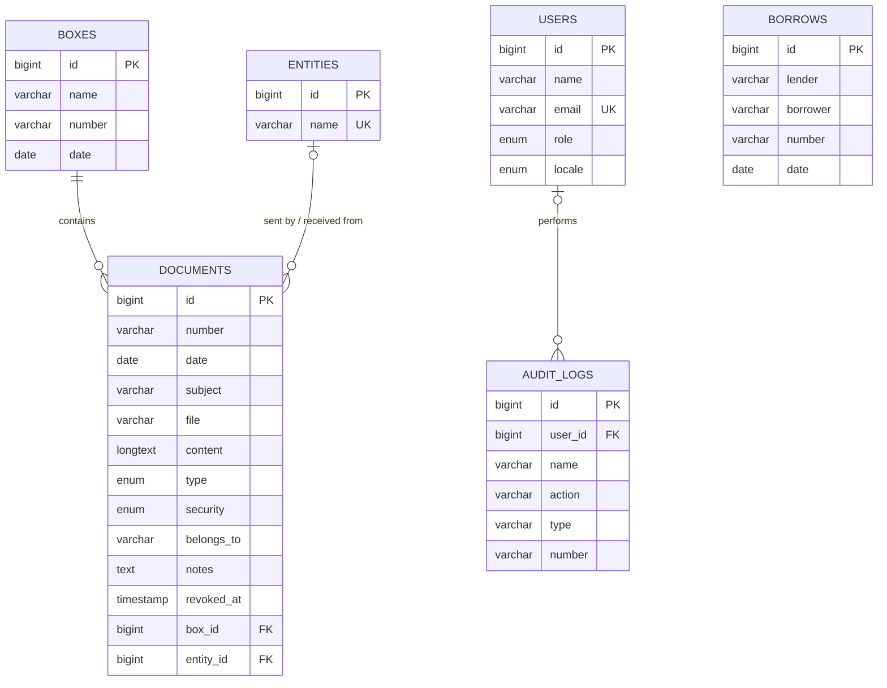

## Database Schema

The E-Archive uses a MySQL/MariaDB database (`InnoDB`, `utf8mb4_unicode_ci`). It stores archived correspondence (documents), the physical boxes they are filed in, the entities they are exchanged with, document borrowing records, application users, and an audit trail.

### Entity Relationship Diagram

### Tables Overview

| Table        | Purpose                                                                 |
| ------------ | ----------------------------------------------------------------------- |
| `documents`  | Archived incoming/outgoing documents, with full-text searchable content |
| `boxes`      | Physical archive boxes that group documents                             |
| `entities`   | Organizations/parties that documents are exchanged with                 |
| `borrows`    | Records of documents lent from one party to another                     |
| `users`      | Application users, roles, and two-factor authentication data            |
| `audit_logs` | Log of actions users perform on documents                               |

All tables include `created_at` and `updated_at` timestamps (managed by Laravel/Eloquent).

---

### `documents`

The core table of the system.

| Column       | Type                          | Nullable | Description                                           |
| ------------ | ----------------------------- | -------- | ----------------------------------------------------- |
| `id`         | `bigint unsigned`             | No       | Primary key (auto-increment)                          |
| `number`     | `varchar(50)`                 | No       | Document reference number                             |
| `date`       | `date`                        | No       | Document date                                         |
| `subject`    | `varchar(255)`                | No       | Document subject/title                                |
| `file`       | `varchar(255)`                | Yes      | Path/name of the stored scanned file                  |
| `content`    | `longtext`                    | Yes      | Extracted text content (used for full-text search)    |
| `type`       | `enum('Incoming','Outgoing')` | No       | Direction of the document                             |
| `security`   | `enum('Normal','Secure')`     | No       | Confidentiality level                                 |
| `belongs_to` | `varchar(50)`                 | Yes      | Reference to a related/parent document number         |
| `notes`      | `text`                        | Yes      | Free-form notes                                       |
| `revoked_at` | `timestamp`                   | Yes      | Set when the document is revoked; `NULL` means active |
| `box_id`     | `bigint unsigned`             | No       | FK → `boxes.id`                                       |
| `entity_id`  | `bigint unsigned`             | Yes      | FK → `entities.id`                                    |

**Constraints & indexes**

- **Unique:** `documents_number_date_unique` on (`number`, `date`). The same number may be reused on a different date, but not on the same date.
- **Full-text:** `documents_content_fulltext` on `content`.
- **Foreign keys:**
    - `box_id` → `boxes.id` (`ON DELETE CASCADE`, `ON UPDATE CASCADE`). Deleting a box deletes its documents.
    - `entity_id` → `entities.id` (`ON DELETE SET NULL`, `ON UPDATE CASCADE`). Deleting an entity keeps its documents but clears the link.

---

### `boxes`

| Column   | Type              | Nullable | Description                           |
| -------- | ----------------- | -------- | ------------------------------------- |
| `id`     | `bigint unsigned` | No       | Primary key                           |
| `name`   | `varchar(255)`    | No       | Box name/label                        |
| `number` | `varchar(20)`     | No       | Box number                            |
| `date`   | `date`            | No       | Box date (e.g., the archiving period) |

**Constraints:** unique on (`number`, `date`).

---

### `entities`

| Column | Type              | Nullable | Description |
| ------ | ----------------- | -------- | ----------- |
| `id`   | `bigint unsigned` | No       | Primary key |
| `name` | `varchar(255)`    | No       | Entity name |

**Constraints:** `entities_name_unique` on `name`.

---

### `borrows`

Tracks documents lent out. This table is intentionally standalone: it stores names and a document number as plain text rather than foreign keys.

| Column     | Type              | Nullable | Description                                   |
| ---------- | ----------------- | -------- | --------------------------------------------- |
| `id`       | `bigint unsigned` | No       | Primary key                                   |
| `lender`   | `varchar(255)`    | No       | Name of the person/party lending the document |
| `borrower` | `varchar(255)`    | No       | Name of the person/party borrowing it         |
| `number`   | `varchar(50)`     | No       | Document number being borrowed                |
| `date`     | `date`            | No       | Date of the borrow                            |

---

### `users`

| Column                      | Type                          | Nullable | Description                       |
| --------------------------- | ----------------------------- | -------- | --------------------------------- |
| `id`                        | `bigint unsigned`             | No       | Primary key                       |
| `name`                      | `varchar(255)`                | No       | Full name                         |
| `email`                     | `varchar(255)`                | No       | Login email (unique)              |
| `password`                  | `varchar(255)`                | No       | Hashed password                   |
| `role`                      | `enum('sudo','admin','user')` | No       | Access level (default `user`)     |
| `locale`                    | `enum('en','ar')`             | No       | Interface language (default `en`) |

**Constraints:** `users_email_unique` on `email`.

---

### `audit_logs`

| Column    | Type              | Nullable | Description                                           |
| --------- | ----------------- | -------- | ----------------------------------------------------- |
| `id`      | `bigint unsigned` | No       | Primary key                                           |
| `user_id` | `bigint unsigned` | Yes      | FK → `users.id`                                       |
| `name`    | `varchar(50)`     | No       | Name of the user at the time of the action            |
| `action`  | `varchar(20)`     | No       | Action performed (e.g., created, updated, deleted)    |
| `type`    | `varchar(20)`     | No       | Type of the affected record (e.g., incoming/outgoing) |
| `number`  | `varchar(50)`     | No       | Number of the affected document                       |

**Constraints:** `user_id` → `users.id` (`ON DELETE SET NULL`). Because the user's `name` is stored in the log row, entries remain meaningful after a user is deleted.

---

### Relationships Summary

| Relationship             | Type                   | On delete                       |
| ------------------------ | ---------------------- | ------------------------------- |
| `boxes` → `documents`    | One-to-many            | Cascade (documents are deleted) |
| `entities` → `documents` | One-to-many (optional) | Set `NULL`                      |
| `users` → `audit_logs`   | One-to-many (optional) | Set `NULL`                      |

### Design Notes

- **Revocation:** documents are never flagged by a boolean; a non-null `revoked_at` marks a document as revoked.
- **Loose references:** `documents.belongs_to`, `borrows.number`, and `audit_logs.number` refer to document numbers as plain strings, not foreign keys, so they are not enforced by the database. Since `number` is only unique together with `date`, the same number can match more than one document.
- **Security levels:** `documents.security` (`Normal`/`Secure`) should be enforced at the application layer (e.g., via policies keyed on `users.role`).
- **Localization:** `users.locale` supports English (`en`) and Arabic (`ar`); `utf8mb4` collation ensures Arabic text is stored and searched correctly.
